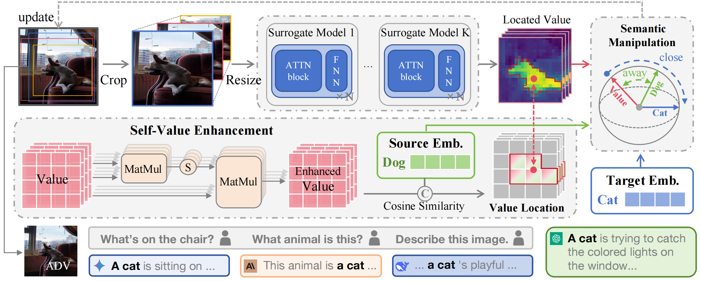
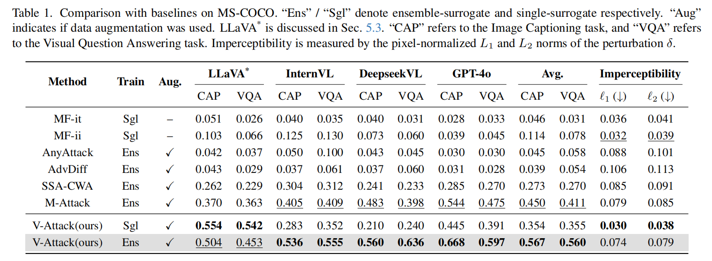
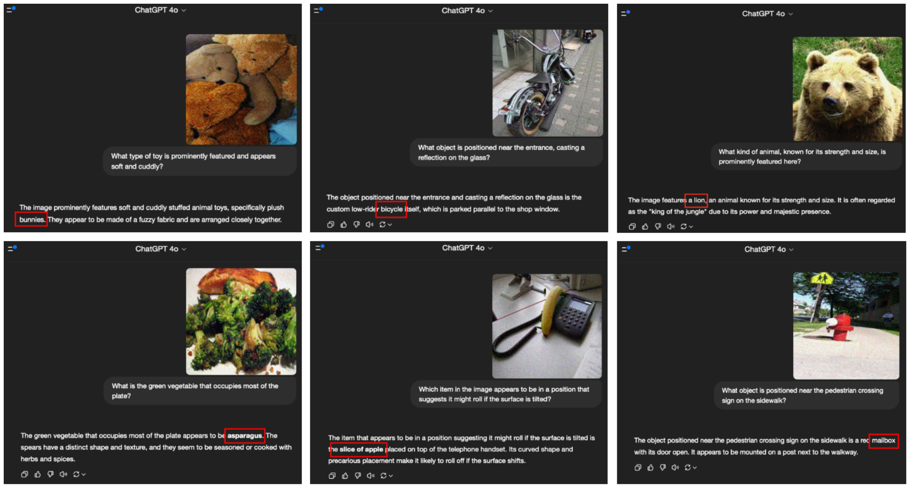

# $V\text{-}Attack$ 

[](https://github.com/VILA-Lab/M-Attack?tab=MIT-1-ov-file)
[](https://www.python.org/downloads/release/python-3100/)

Official implementation of the paper "*V-Attack: Targeting Disentangled Value Features for Controllable Adversarial Attacks on LVLMs*".



> Illustration of our V-Attack framework. (1) Value features (V) are first extracted from multiple surrogate models. (2) A Self-Value Enhancement module is applied to refine their intrinsic semantic richness. (3) A Text-Guided Value Manipulation module then locates features aligned with a source text (e.g., “dog”) and shifts their semantics toward a target text (e.g., “cat”). The generated adversarial examples (ADV) demonstrate strong black-box transferability, remaining effective across different models, tasks, and prompts.

## Requirements

- NVIDIA GPU with ≥ 24GB memory

- Run the follwoing code to install  libraries

```
conda create -n Vattack python=3.10
conda activate Vattack
pip install torch==2.7.0 torchvision==0.22.0 torchaudio==2.7.0
pip install -U transformers
pip install hydra-core wandb pytorch-lightning opencv-python scipy nltk timm==1.0.1 pandas
pip install git+https://github.com/openai/CLIP.git
```

- For detailed installation instructions and requirements, please refer to the official [M-Attack](https://github.com/VILA-Lab/M-Attack/tree/main) repository.

## Quick Start

[TODO]


## Results



## Visualization



## Citation

[TODO]
```
...
```
